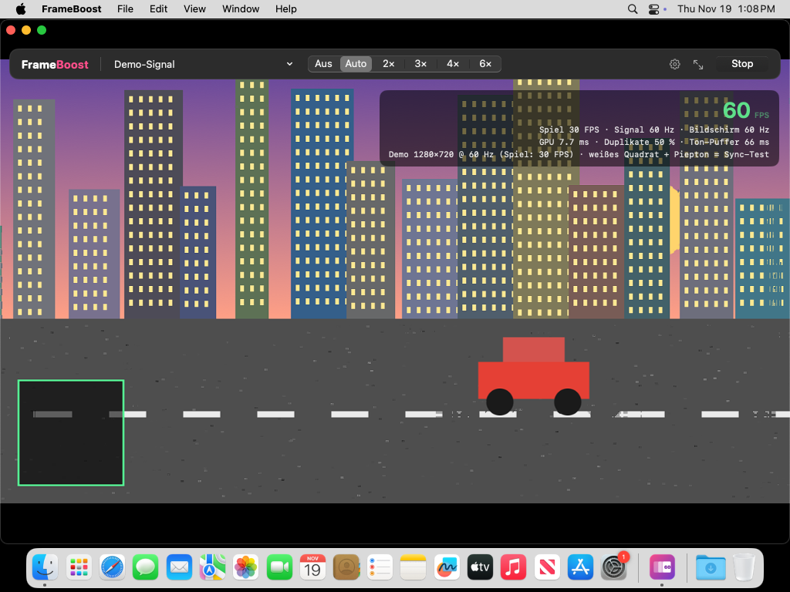
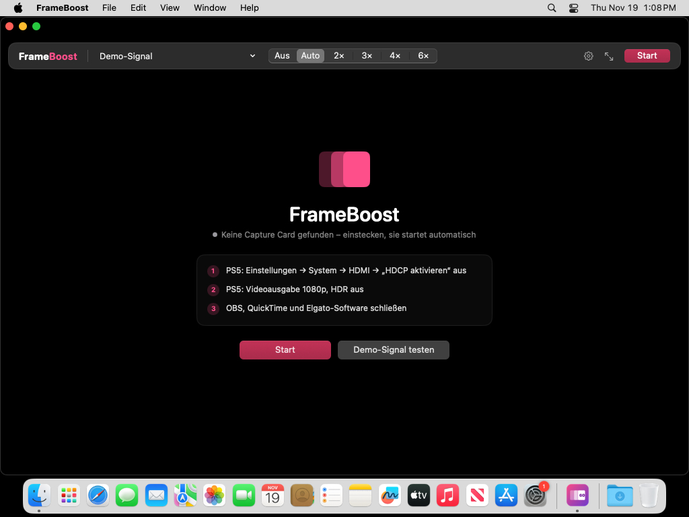
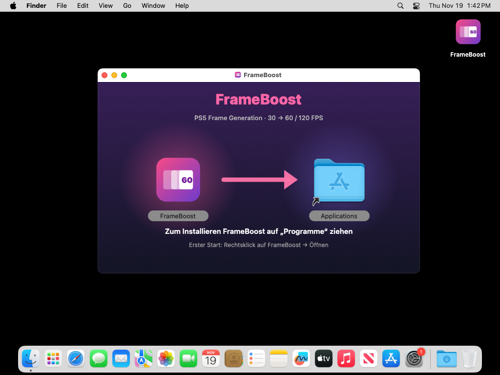
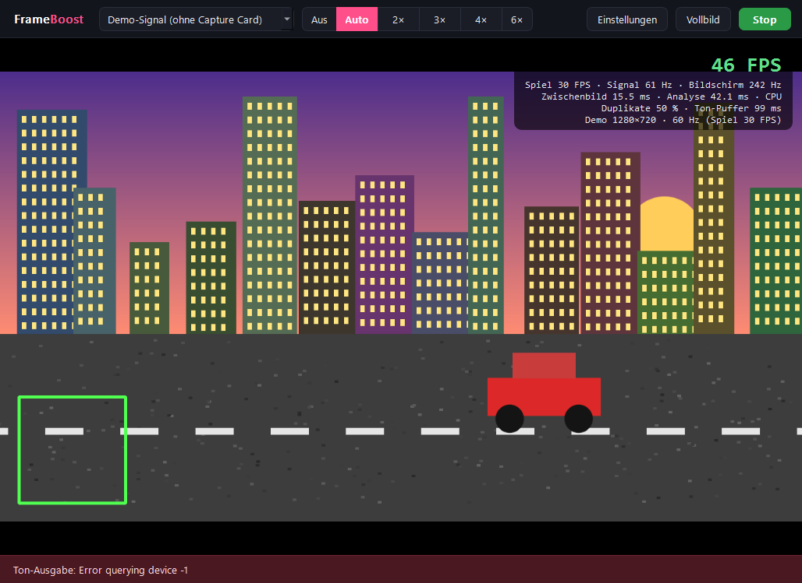
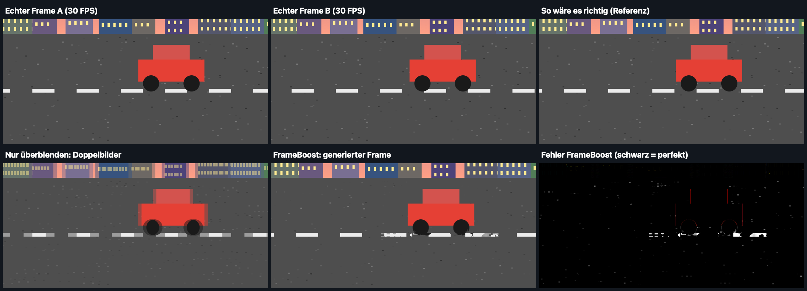

# FrameBoost

**Frame Generation für Konsolen über eine Capture Card.** Aus 30 FPS werden 60, 120 oder 180 FPS – für macOS und Windows.

Die PS5 (oder jede andere Konsole) läuft über eine Capture Card in den Computer. FrameBoost erkennt die Karte automatisch,
berechnet zwischen zwei echten Bildern neue Zwischenbilder und zeigt sie in der Bildwiederholrate deines Bildschirms an.
Der Ton wird so verzögert, dass Bild und Ton synchron bleiben.

| Start | Installation (Mac) | Windows |
|---|---|---|
|  |  |  |

## Download

| System | Datei | Voraussetzungen |
|---|---|---|
| macOS | [FrameBoost.dmg](../../releases/latest) (3 MB) | macOS 14 oder neuer · Apple Silicon (M1–M5, nativ) und Intel |
| Windows | [FrameBoost.exe](../../releases/latest) (64 MB) | Windows 10/11 (64 Bit), Grafikkarte empfohlen |

**Erster Start auf dem Mac:** Die App ist (noch) nicht bei Apple notarisiert. Rechtsklick auf FrameBoost → *Öffnen* → *Öffnen*.
**Erster Start unter Windows:** Bei der SmartScreen-Warnung auf *Weitere Informationen* → *Trotzdem ausführen* klicken.

## Einrichtung

1. Konsole → HDMI → Capture Card → USB 3.0 am Computer.
2. PS5: *Einstellungen → System → HDMI → „HDCP aktivieren“* **aus** (sonst bleibt das Bild schwarz).
3. PS5: Videoausgabe **1080p**, **HDR aus**.
4. OBS, QuickTime, Kamera-Apps und Hersteller-Software schließen – sonst ist die Karte belegt.
5. FrameBoost starten. Die Capture Card wird erkannt und startet automatisch, inklusive Ton.

**Günstige Karten:** USB-3.0-Sticks mit dem Chip **MS2130** (ca. 15–35 €) liefern 1080p mit 60 Hz ohne Komprimierung und reichen völlig,
z. B. die UGREEN Video Capture Card (Modell 25854, USB-C und USB-A). Beim Kauf auf **„USB 3.0“** und **„1080P 60Hz“ als Aufnahme**
achten. Karten mit „USB 2.0“ oder „1080P 30Hz“ liefern 1080p nur mit 30 Hz (oder weniger); FrameBoost nimmt dann automatisch
720p mit 60 Hz, weil der volle 60-Hz-Takt für flüssige Zwischenbilder wichtiger ist. Teurere Karten (Elgato, AVerMedia) funktionieren ebenfalls.
Auf dem Mac (auch M1–M5) braucht keine dieser Karten einen Treiber.

**Warum ist die EXE größer als die DMG?** Die Mac-App nutzt Metal, SwiftUI und AVFoundation, die in macOS eingebaut sind.
Die Windows-EXE muss Python, Qt (Oberfläche), OpenCV (Bildverarbeitung) und NumPy mitbringen.

## Ohne Konsole ausprobieren

Im Quellen-Menü *Videodatei als Capture Card …* wählen: Ein beliebiges Video (z. B. eine 30-FPS-Aufnahme) läuft dann
genau wie eine Capture Card – als 60-Hz-Signal, jedes Bild doppelt, wie bei der PS5. So lässt sich die Frame Generation
ohne Konsole und Karte testen. Das *Demo-Signal* zeigt zusätzlich einen Bild/Ton-Sync-Test.

## Bedienung

| Mac | Windows | Funktion |
|---|---|---|
| ⌃⌘F | F11 | Vollbild |
| ⌘0 · ⌘1 · ⌘2 · ⌘3 · ⌘4 · ⌘6 | Strg+0 · 1 · 2 · 3 · 4 · 6 | Frame Generation Aus · Auto · 2× · 3× · 4× · 6× |
| ⌘I | Strg+I | FPS-Anzeige |
| ⇧⌘S | Strg+Umschalt+S | Start / Stop |
| ⌘, | Einstellungen | Einstellungen |

**Auto** erzeugt so viele Bilder, wie dein Bildschirm darstellen kann: 60 Hz → 60 FPS, 120 Hz → 120 FPS, 180 Hz → 180 FPS.
Auf 180-Hz-Monitoren laufen *Auto*, *3×* und *2×* besonders gleichmäßig. Ein 1080p-Bild auf einem 1080p-Monitor wird im Vollbild 1:1 angezeigt.

**Ton-Sync testen:** Demo-Signal starten – einmal pro Sekunde erscheint ein weißes Quadrat zusammen mit einem Piepton.
Beides muss gleichzeitig kommen; sonst in den Einstellungen unter *Ton → Feinabstimmung* nachregeln.

## So funktioniert es

1. **Doppelte Bilder entfernen.** Die PS5 sendet immer 60 Hz. Bei einem 30-FPS-Spiel ist jedes Bild doppelt.
   FrameBoost erkennt Wiederholungen (die Schwelle passt sich dem Rauschen der Karte an) und arbeitet nur mit den echten Bildern.
2. **Bewegung messen.** Zwischen den zwei letzten echten Bildern wird für jeden Bildbereich die Bewegung bestimmt – in beide Richtungen.
   - *Mac:* eigene Block-Matching-Pipeline in Metal (1/16 → 1/8 → 1/4 → 1/2 Auflösung, Sub-Pixel-Genauigkeit, Vorhersage aus dem letzten Bildpaar).
   - *Windows:* dichter optischer Fluss (DIS) auf einem eigenen Thread.
3. **Zwischenbild erzeugen.** Bei jedem Bildschirm-Refresh wird genau der passende Zeitpunkt zwischen den beiden Bildern berechnet.
   Auf dem Mac wählt die GPU pro Pixel die beste von neun Bewegungen aus, was saubere Kanten ergibt. Verdeckte Bereiche und Bildränder werden gesondert behandelt.
4. **Szenenwechsel** (Menü, Kameraschnitt) werden erkannt – dort wird nicht gemorpht.
5. **Ton-Puffer.** Der Ton läuft durch einen Ringpuffer und wird genau um die Bildverzögerung verschoben.

Die zusätzliche Verzögerung beträgt etwa ein echtes Bild (≈ 33 ms bei 30 FPS) – das ist bei jeder Frame Generation so.

## Getestet

Jede Version läuft vor der Veröffentlichung automatisch durch Selbsttest (Bildqualität, Ton-Sync, Duplikate, Szenenwechsel)
und einen Dauertest, der 10 Minuten lang alle Funktionen durchklickt. Dazu läuft ein echter Film als 30-FPS-„Capture Card“
durch die App: **60 FPS gelockt** (Mac, 99,6 % neue Bilder pro Refresh). Ergebnisse und behobene Fehler: [TESTBERICHT.md](TESTBERICHT.md).

## Probleme melden

Am einfachsten über den eingebauten Bericht:
**Mac:** *Hilfe → Fehlerbericht erstellen …* · **Windows:** *Einstellungen → Fehlerbericht erstellen*.
Die Datei landet auf dem Schreibtisch; dann ein [Issue](../../issues/new/choose) erstellen und sie anhängen.
Nach einem Absturz bietet FrameBoost den Bericht beim nächsten Start automatisch an.

## Selbst bauen

**macOS** (Xcode Command Line Tools): `./scripts/build_dmg.sh` → `build/FrameBoost.dmg`
Selbsttest: `FrameBoost.app/Contents/MacOS/FrameBoost --selftest ordner/` · Dauertest: `--soak 600 --soak-dir ordner/` · Videotest: `--videotest video.mp4 --soak-dir ordner/`

**Windows** (Python 3.12): `cd windows && pip install -r requirements.txt && python main.py`
EXE: siehe `.github/workflows/windows.yml` (PyInstaller) · Selbsttest: `python main.py --selftest ordner`

Jeder Push baut beide Versionen automatisch, führt Selbsttest und Dauertest aus und legt die Dateien unter *Releases* ab.

---

### English

FrameBoost turns a console's 30 FPS capture card signal into 60/120/180 FPS using its own motion-compensated frame generation
(Metal on macOS, OpenCV on Windows), keeps audio in sync with a delay buffer and detects capture cards automatically.
Download the DMG / EXE from *Releases*. PS5: disable HDCP, set 1080p and turn HDR off.
